# AttackLens — Kill Chain and Attack Path Analysis

**Mitigata CyberForge finals · Problem 01 · Team of 2**

AttackLens reads a large security-log data set (15–50 GB) as a stream, finds the hidden attack, labels every step
with a **MITRE ATT&CK** technique and tactic, links the steps into **one attack path**, and shows it as a timeline and
a graph, together with **what the attacker can reach next**. It runs fully offline on one laptop.

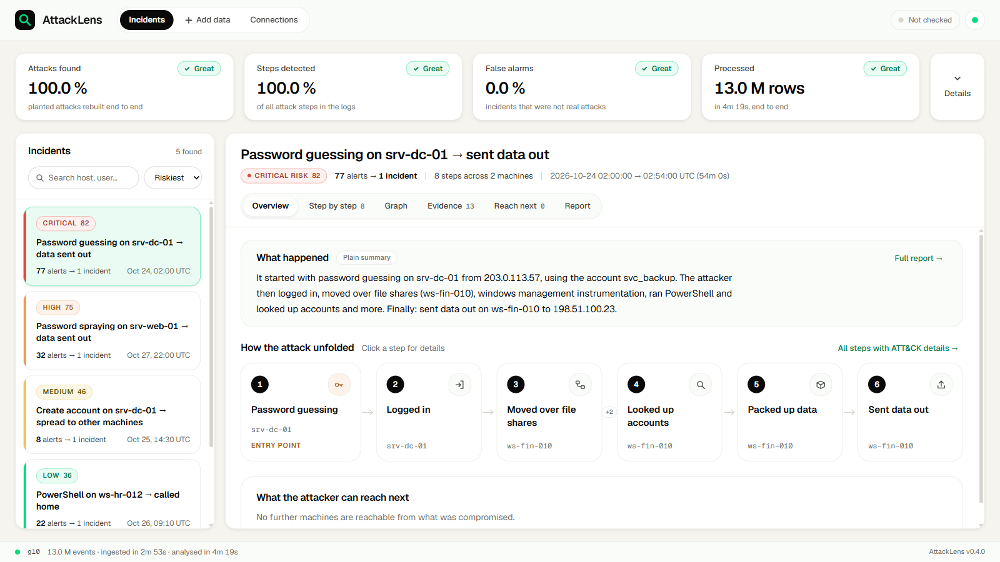

<sub>Screenshot of the `g10` run: 10.7 GB of synthetic logs with 5 planted attacks (numbers in section 6).</sub>

---

## Contents

1. [Start it in 3 steps (Docker)](#1-start-it-in-3-steps-docker)
2. [Guided tour: what to look at](#2-guided-tour-what-to-look-at)
3. [Analyse your own logs](#3-analyse-your-own-logs)
4. [The problem and our approach](#4-the-problem-and-our-approach)
5. [How it works](#5-how-it-works)
6. [Measured results](#6-measured-results)
7. [Run without Docker](#7-run-without-docker)
8. [Configuration: add a detection rule](#8-configuration-add-a-detection-rule)
9. [Data formats](#9-data-formats)
10. [Detection coverage](#10-detection-coverage)
11. [SIEM and cloud integrations](#11-siem-and-cloud-integrations)
12. [API reference](#12-api-reference)
13. [Design decisions](#13-design-decisions)
14. [Security, LLM safety and data handling](#14-security-llm-safety-and-data-handling)
15. [Repository layout](#15-repository-layout)
16. [Disclosures (third-party components)](#16-disclosures-third-party-components)
17. [More documents](#17-more-documents)

---

## 1. Start it in 3 steps (Docker)

### What you need

| Item | Requirement |
|---|---|
| Docker | Docker Desktop (Windows / macOS) or Docker Engine with the Compose plugin (`docker compose version` works) |
| Memory | about 8 GB free for Docker (the pipeline caps its database engine at 5 GB) |
| Disk | about 3 GB free |
| Network | only to build the image (downloads base images and packages). Running needs no network |

### Step 1 — Get the code

```bash
git clone https://github.com/kandiharish/AttackLens.git
cd AttackLens
```

### Step 2 — Build and start

```bash
docker compose up -d --build
```

This one command builds the image and starts the container in the background. On the **first start** the container
creates its own demo data (a 200 MB synthetic log set with 5 planted attacks and their ground truth) and analyses it.
Later starts reuse the result from `./data` and are ready in seconds.

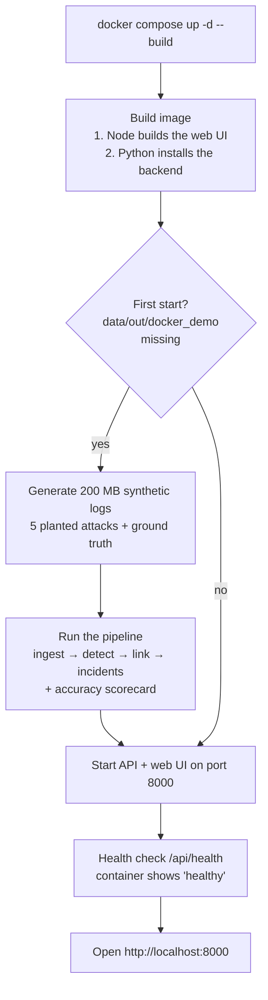

How long each part took on our laptop (Intel i5-13420H, 16 GB RAM, Windows 11, Docker 29.7.2):

| Part | Time |
|---|---|
| Build the image | 2.4 min with some layers cached. A first build also downloads Node, Python and packages, so it takes longer |
| First start: generate data + analyse | about 11 min. The analysis alone took 650.7 s (`data/out/docker_demo/run_metrics.json`) |
| Later starts | a few seconds |

> **Why the first start is slower in Docker on Windows:** the container writes to `./data` through a Windows bind
> mount, which is slow. The same 210 MB set took **64.3 s natively** (`data/out/demo/run_metrics.json`) against
> 650.7 s in the container. On Linux, or with the native setup in section 7, it is much faster.

### Step 3 — Check it is ready, then open it

```bash
docker compose ps          # STATUS must show "healthy"
docker compose logs -f     # optional: watch progress, Ctrl+C to stop watching
```

What the log shows, in order:

| Log line | Meaning |
|---|---|
| `attacklens: generating demo data set docker_demo (200M)` | first start only: creating the synthetic logs |
| `stage profile start` … `stage publish done` | the pipeline stages running (first start only) |
| `done in … s, peak RSS … MB` | analysis finished |
| `Uvicorn running on http://0.0.0.0:8000` | the app is up |

Open **http://localhost:8000** in your browser. Quick check from a terminal: `curl http://localhost:8000/api/health`
should return `"status":"ok"` and `"incidents":5`.

### Everyday commands

| Task | Command |
|---|---|
| Port 8000 already in use | bash: `ATTACKLENS_PORT=8001 docker compose up -d` · PowerShell: `$env:ATTACKLENS_PORT=8001; docker compose up -d` |
| Stop | `docker compose down` |
| Start again (keeps the analysed data) | `docker compose up -d` |
| Start from scratch | `docker compose down`, delete `data/raw/docker_demo` and `data/out/docker_demo`, then `docker compose up -d` |

### Troubleshooting

| Symptom | Fix |
|---|---|
| `docker: command not found` or "cannot connect to the Docker daemon" | Start Docker Desktop and wait until it says it is running |
| `port is already allocated` | Use another port: `ATTACKLENS_PORT=8001 docker compose up -d`, then open http://localhost:8001 |
| Status stays `health: starting` | Normal on the first start (it can take up to about 11 min, see above). Watch `docker compose logs -f` |
| Container exits or restarts during the first start | Give Docker more memory (8 GB or more) in Docker Desktop settings, then `docker compose up -d` |
| Build fails on `npm ci` or `pip install` | The build needs internet. Check the connection or proxy, then run `docker compose up -d --build` again |
| Page loads but shows no incidents | The first analysis is still running. Wait for `Uvicorn running`, then reload the page |

Security note: the port is published on `127.0.0.1` only, because the upload and run endpoints have no login.
Keep it that way (section 14).

---

## 2. Guided tour: what to look at

About 2 minutes. Every number on screen is read from the metric files of the run being shown.

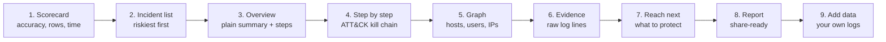

| # | Where | What you see | Why it matters |
|---|---|---|---|
| 1 | **Scorecard** (top row) | Attacks found, steps detected, false alarms, rows processed. **Details** opens labels accuracy, peak memory, run time per stage and dropped rows | Accuracy is measured against planted ground truth (`eval_scorecard.json`), speed and memory against `run_metrics.json` |
| 2 | **Incident list** (left) | Incidents sorted by risk 0–100, each with "N alerts → 1 incident" | Thousands of alerts become a handful of incidents |
| 3 | **Overview** tab | "What happened" summary, the attack steps as cards, the entry point | The story in one screen |
| 4 | **Step by step** tab | The 15 ATT&CK tactics as a bar (green = seen, dashed = gap), each step with technique ID, tactic, host, user, IP, confidence, and the reason it is linked to the next step | Every step is labelled and explained |
| 5 | **Graph** tab | Hosts, users and IPs; compromised nodes in red; arrows = steps in time order; hover an arrow for the link reason | The attack path at a glance |
| 6 | **Evidence** tab | The original log lines behind each step | Nothing is a black box |
| 7 | **Reach next** tab | Machines reachable from what is already compromised, with hops, account and evidence | What to protect first |
| 8 | **Report** tab | A share-ready incident report with a `template` or `llm` badge | Works offline (section 14) |
| 9 | **Add data** page | Upload logs or point at a file on disk, press Analyse | Try it on your own logs (section 3) |

Click any step card to open its **raw details** panel: technique, rule, confidence, entities and the log line.

| Step by step | Graph |
|---|---|
| 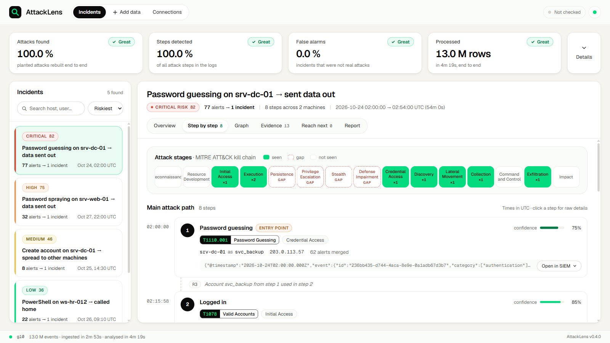 | 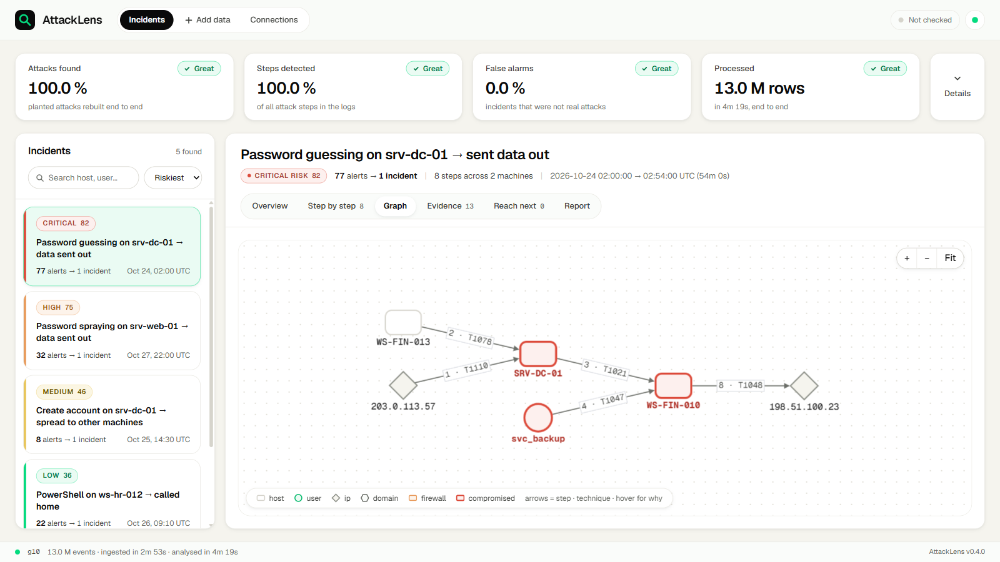 |
| **Reach next** (from the `g30` run) | **Report** |
| 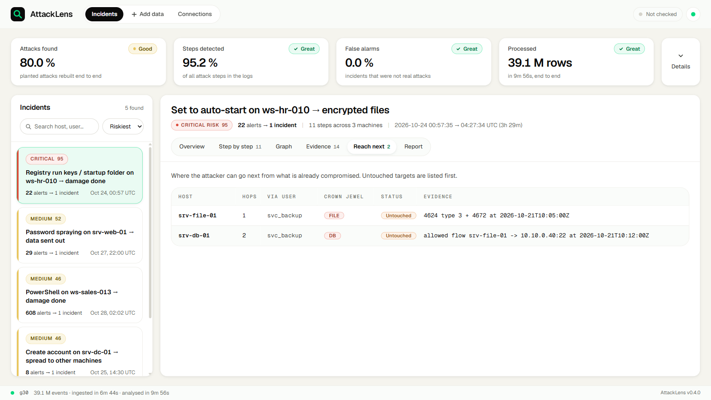 | 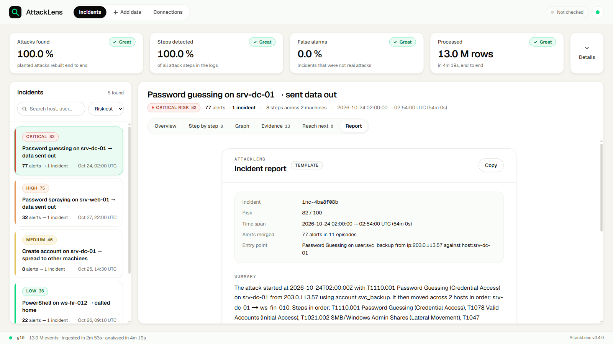 |

---

## 3. Analyse your own logs

No terminal is needed. Open **Add data** in the top bar.

| Step | What to do | What happens |
|---|---|---|
| 1. Choose logs | Drag files onto "Drop log files here", or type a full path under "Use a file already on this computer" | Upload: the browser streams the file to the API with a progress bar. Path: the API makes a hard link, nothing is copied |
| 2. Analyse | Press **Analyse these logs** | The pipeline starts. A tracker shows each stage with percent, elapsed time and memory |
| 3. Results | When the run succeeds, open an incident | The app serves the new results from then on |

Accepted: firewall, Windows, EDR, syslog, CEF, CSV and JSON logs (`.log .txt .csv .json .jsonl .ndjson .cef .syslog`).
The format is detected from the content, not the file name (section 9).

**With Docker**, the container sees only the repository's `data/` folder (mounted at `/app/data`). For a large file,
copy it into `data/` on your machine and enter the container path, for example `/app/data/mylogs/firewall.log`.
Uploading through the browser also works but writes a second copy of the file.

What happens behind the page:

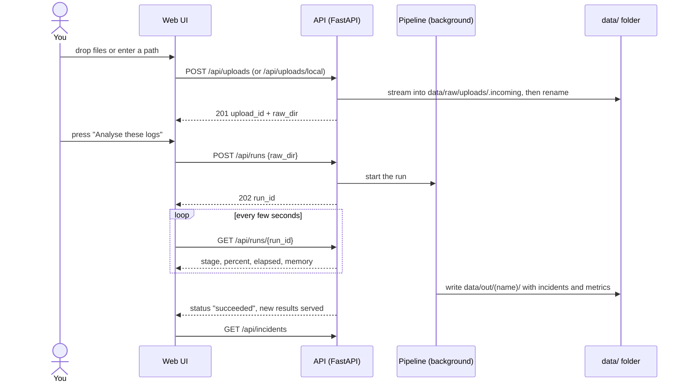

A run moves through these states:

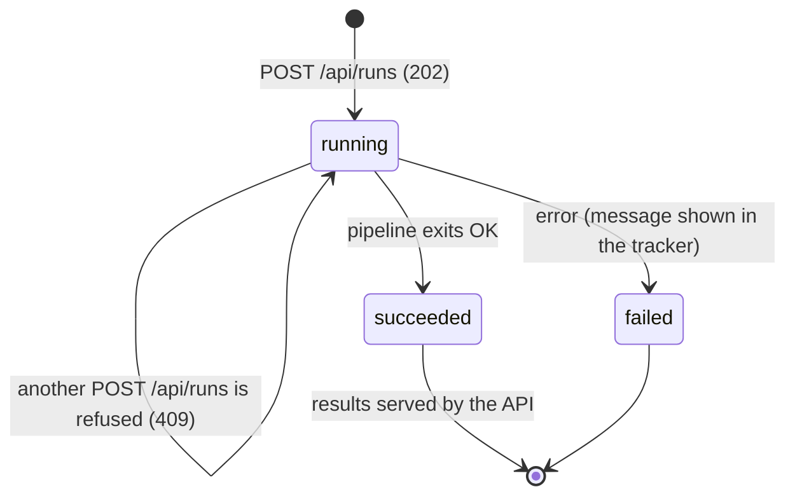

Only one run can be active at a time, because the pipeline needs the whole memory budget. The full upload and run
API, its limits and error codes are in section 12.

---

## 4. The problem and our approach

**The problem.** An attack is a handful of log lines (a password guess, a login, a move to another machine, data
sent out) hidden among millions of normal lines, often hours and millions of lines apart. Each step looks harmless on
its own. Usual tools raise thousands of separate alerts, and an analyst links them by hand.

**What the challenge asks** (`docs/PRD.md`):

| Requirement | Where in AttackLens |
|---|---|
| FR-1 Read all data without loading it into memory | Stage 1 ingest: one DuckDB `COPY` to Parquet, `memory_limit='5GB'`; peak memory in `run_metrics.json` |
| FR-2 Detect suspicious events | Stage 3 detect: every rule in `config/rules.yaml` is one SQL query, plus the SigmaHQ catalogue |
| FR-3 ATT&CK technique + kill-chain stage | Each alert and step carries `technique_id` and `tactic` (ATT&CK v20); badges in the UI |
| FR-4 Link events into one incident | Stage 5 link (keyed joins on host, user, IP, time) + Stage 6 components |
| FR-5 Timeline and graph | Incident screen: ordered steps, kill-chain bar, graph; `GET /api/incidents/{id}/path` |
| FR-6 What the attacker can reach next | Stage 6 reach-next (up to 3 hops over admin, group and network-flow edges), with evidence |
| FR-7 API or page + short README | FastAPI (section 12) + web UI + this README |
| B-1 Risk score, worst on top | `risk` 0–100 per incident; list sorted by risk |
| B-2 Plain-English incident report | Report tab with a `llm` or `template` badge |
| B-3 Alerts merged per incident | `merged_alert_count` ("77 alerts → 1 incident") |
| B-4 Add a rule by editing config | `config/rules.yaml` (section 8), plus SigmaHQ rules in `config/sigma/` |
| B-5 Live mode | `python -m attacklens.live --watch data/raw/live --out data/out/live` (section 7.6) |

**Our approach in one line:** let a database engine do the heavy lifting on disk, turn alerts into short
"episodes", link episodes only when they share real evidence (same user, host or IP inside a time window), and keep
the best-ordered chain of steps as the attack path.

**AttackLens works on top of a SIEM, not instead of one.** File ingest is the scored path. SIEM connectors exist
and are tested against a local mock SIEM only (section 11).

---

## 5. How it works

### 5.1 The pipeline

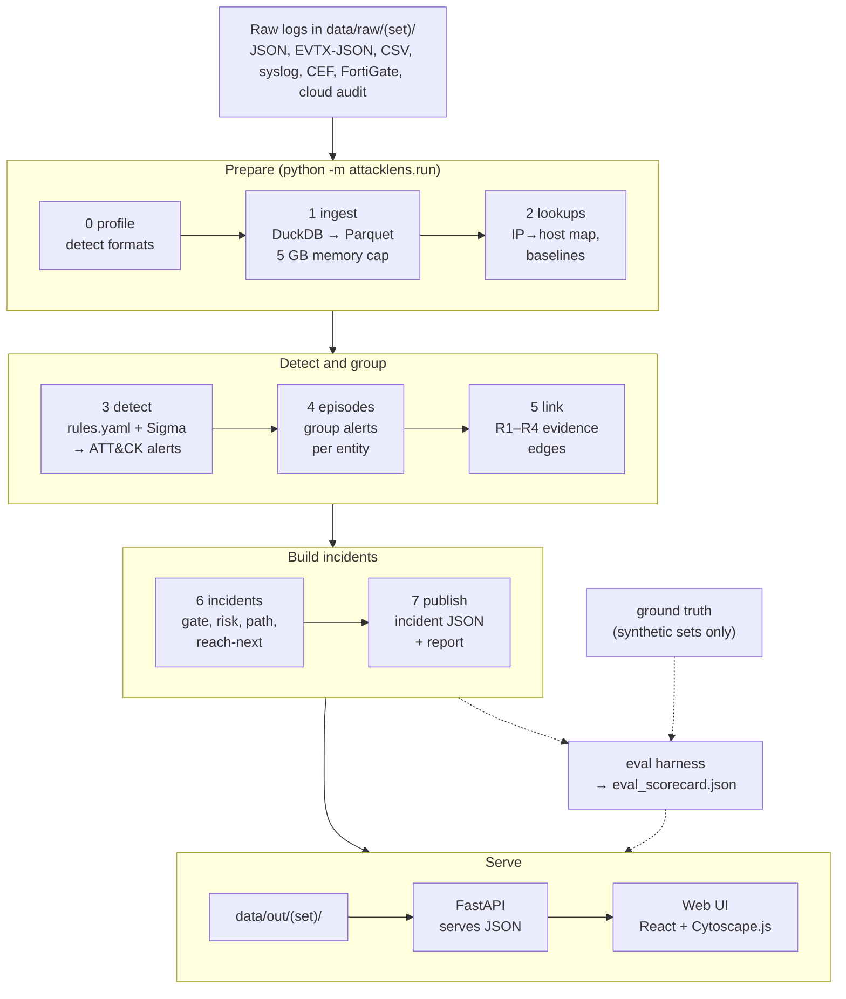

| Stage | What it does | Main output |
|---|---|---|
| 0 profile | Detects each file's format from its content and resolves field names via `config/sources.yaml` | `source_profile.json` |
| 1 ingest | Streams all sources into partitioned Parquet in one pass; counts rows in, ok and dropped | Parquet + `ingest_accounting.json` |
| 2 lookups | Builds the IP-to-host map, the list of busy "hub" entities and per-rule host baselines | small Parquet tables |
| 3 detect | Runs each rule as SQL; each hit is an alert with technique, tactic and severity | `raw_alerts.parquet` |
| 4 episodes | Groups alerts into 5-minute episodes per entity and counts merged alerts | episodes |
| 5 link | Joins episodes that share host, user or IP inside a time window, and stores why | `edges.parquet` |
| 6 incidents | Connected components, confidence gate, risk score, best ordered path, reach-next | incidents |
| 7 publish | Writes one JSON file per incident, the index and the report | `incidents/{id}.json`, `incidents_index.json` |

Side outputs: `run_metrics.json` (time and peak memory per stage, sampled every 500 ms) and, when ground truth is
given, `eval_scorecard.json`.

Design rules:
- DuckDB does all heavy work and spills to disk. Python never loops over raw events.
- Every stage reads and writes files, so any stage can be re-run alone (`--from-stage N`).
- Detection uses raw fields only. The generator's label fields are ground truth and are stripped before ingest.
- All times are UTC.

### 5.2 From alerts to one incident

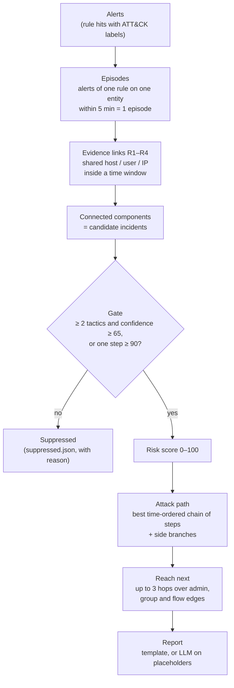

The four link rules (windows from `config/linking.yaml`):

| Rule | Links two steps when… | Window |
|---|---|---|
| **R1** host hand-off | activity moves from one host to another (the target of one step is the source of the next) | 24 h |
| **R2** same session | the same user is active on the same host | 2 h |
| **R3** account pivot | an account that was guessed, created or elevated is then used | 72 h on the same host, 6 h across hosts |
| **R4** collect → exfiltrate | data is collected, then sent out from the same host | 24 h |

Correlation is **evidence-linked, not causal**: two steps are linked because they share entities inside a time
window. AttackLens does not claim that one step caused the next. Busy shared accounts and hosts ("hubs") are
barred as link keys, so routine activity does not glue unrelated events together.

Risk (from `docs/DEVELOPMENT.md` §6.4):
`risk = min(100, round(90 · raw / raw_ref) + min(10, round(2 · ln(1 + hosts) + ln(1 + merged_alerts))))`,
where `raw = Σ w_t · ln(S_t)` over the tactics seen, `S_t` is the highest severity at tactic `t` on a 1–10 scale,
`w_t = (10 + t) / 10` (later kill-chain stages weigh more), and `raw_ref = 30.8` (section 13).
The gate keeps a component when it has at least 2 tactics and a step with confidence ≥ 65, or any step with
confidence ≥ 90 (`docs/DEVELOPMENT.md` §6).

### 5.3 Example: the attack path AttackLens rebuilt

The riskiest incident of the `g10` run (risk 82, 77 alerts merged, 8 steps on 2 machines, 54 minutes):

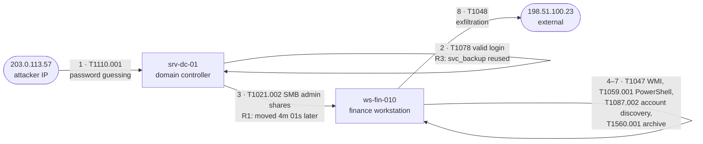

Kill-chain order of that path: Credential Access → Initial Access → Lateral Movement → Execution → Discovery →
Collection → Exfiltration. Source: `data/out/g10/incidents/inc-4ba8f08b.json` (narrative and path).

---

## 6. Measured results

Every number below is copied from a metric file and names it. Metric files do not record the git commit.
Hardware: Intel Core i5-13420H (8 cores / 12 threads), 16 GB RAM, Windows 11, DuckDB `memory_limit 5GB`, one laptop
with other jobs running (contention is described in `reports/stress/`).

### 6.1 Accuracy against planted ground truth (synthetic data)

The synthetic sets come from the provided generator (`reports/edr_log_generator.py`) with 5 planted attacks and
21 planted steps. Source: `data/out/<set>/eval_scorecard.json`.

| Measure | PRD good / great | g1 (1.07 GB) | g10 (10.7 GB) | g30 (32.2 GB) | demo (0.21 GB) |
|---|---|---|---|---|---|
| Detection (planted steps found) | > 70 % / > 90 % | 100.0 % | 100.0 % | 95.24 % | 100.0 % |
| Correct ATT&CK labels | > 60 % / > 85 % | 100.0 % | 100.0 % | 95.0 % | 100.0 % |
| Attacks rebuilt end to end | half / all | 100.0 % | 100.0 % | **80.0 %** | 100.0 % |
| False alarms (strict) | < 30 % / < 10 % | 0.0 % | 0.0 % | 0.0 % | 0.0 % |

Counts behind the g10 and g30 scores (`counts` in the same files, as tabled in `docs/BENCHMARK.md` §3.1):

| Count | g10 | g30 |
|---|---|---|
| Attacks / rebuilt | 5 / 5 | 5 / 4 |
| Planted steps / matched | 21 / 21 | 21 / 20 |
| Labels correct | 21 | 19 |
| Incidents / not matched to an attack | 5 / 0 | 5 / 0 |
| Noise alerts detected / detectable | 5,107 / 5,107 | 15,372 / 15,372 |

### 6.2 Speed and memory

Source: `data/out/<set>/run_metrics.json` (`bytes_in`, `rows_in`, `total_wall_s`, `peak_rss_mb`, `incidents`).

| Set | Input | Events | Time end to end | Peak memory | Incidents |
|---|---|---|---|---|---|
| g1 | 1,074,055,241 bytes | 1,305,403 | 39.2 s | 3,401.3 MB | 5 |
| g10 | 10,737,733,035 bytes | 13,048,132 | 258.5 s (4 min 19 s) | 2,552.9 MB | 5 |
| g30 | 32,212,574,455 bytes | 39,142,706 | 595.5 s (9 min 56 s) | 3,133.0 MB | 5 |
| demo | 210,033,604 bytes | 255,244 | 64.3 s | 1,467.7 MB | 5 |
| docker_demo (same data as demo, in Docker on Windows) | 210,033,604 bytes | 255,244 | 650.7 s | 1,699.3 MB | 5 |

PRD targets: processing < 3 h (good) / < 1 h (great), memory < 16 GB / < 8 GB. Every run above is under both
"great" targets. Opening one incident's path: p50 3.68 ms, p95 26.94 ms over 200 requests on g10
(`reports/stress/g10.md`), against a "great" target of 500 ms.

### 6.3 Real FortiGate logs from the organiser (no ground truth, so no accuracy score)

Source: `reports/stress/real_tiers.md` (from each run's `run_metrics.json` and `ingest_accounting.json`).

| Tier file | Size | Time | Peak memory | Rows ok / dropped | Incidents |
|---|---|---|---|---|---|
| `firex-10G.log` | 6,543,120,032 bytes | 336.7 s | 2,758.4 MB | 9,125,382 / 13,327,641 | 1 |
| `firex-30G.log` | 19,621,285,387 bytes | 222.4 s | 2,444.6 MB | 8,138,878 / 3 | 0 |
| `50g.txt` | 45,474,446 bytes (not 50 GB) | 60.4 s | 206.8 MB | 85,936 / 1 | 0 |

Every dropped row has a logged reason. In `firex-10G.log`, 13,187,868 lines are invalid UTF-8 (`decode_error`).
`firex-30G.log` ends in a 15.3 GB run of NUL bytes that forms one over-long line. Details in `docs/BENCHMARK.md` §6.

### 6.4 Honest limits

- The synthetic sets are small in attack count (5 attacks, 21 steps). 100 % there does not prove the same on real data.
- At 32 GB (g30) one of 5 attacks was not rebuilt end to end (80 %). Suspected causes are listed in `reports/stress/g30.md`.
- On the synthetic FortiGate set `f1`, detection was 23.08 % and no attack was rebuilt (`docs/BENCHMARK.md` §3.1).
- Turning the Sigma catalogue on raised false alarms on the one set where both were measured (section 10.2).
- Cloud and SIEM paths: accuracy, speed and memory are not measured yet.
- Live-mode update latency: not measured yet.

More measurements, including the older `g1x` and `f1` runs and comparisons with other tools' published claims:
`docs/BENCHMARK.md`.

---

## 7. Run without Docker

### 7.1 Prerequisites

| Tool | Version |
|---|---|
| Python | 3.12 |
| Node.js | 20 or newer (with npm) |
| Disk | about 2.5× the raw data size free (Parquet plus spill) |
| RAM | 16 GB recommended; the pipeline caps DuckDB at 5 GB |

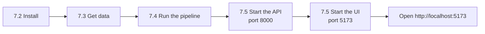

### 7.2 Install

Windows, Git Bash:
```bash
python -m venv .venv
.venv/Scripts/python -m pip install -e "backend[dev]"
```
Windows, PowerShell:
```powershell
python -m venv .venv
.\.venv\Scripts\python -m pip install -e "backend[dev]"
```
Linux / macOS:
```bash
python3.12 -m venv .venv
.venv/bin/python -m pip install -e "backend[dev]"
```
Below, `PY` means `.venv/Scripts/python` (Windows) or `.venv/bin/python` (Linux / macOS).
The optional LLM report wording needs `pip install -e "backend[llm]"`. It is not needed for the demo.

### 7.3 Get data

Option A — synthetic data with planted attacks (wraps the provided `reports/edr_log_generator.py`):
```bash
PY tools/gen_dataset.py --size 1G --out data/raw/g1
```
Sizes accept `K`, `M` and `G`. The same seed gives the same attacks at every size. Options: `docs/TESTING.md` §3.1.

Option B — your own logs: put the files in `data/raw/<set>/`. Formats are detected by content (section 9).

### 7.4 Run the pipeline

```bash
PY -m attacklens.run --raw data/raw/g1 --out data/out/g1 \
   --ground-truth data/raw/g1/ground_truth/attacks.json
```
`--ground-truth` is optional; without it there is no accuracy scorecard. Other flags: `--parquet <dir>` (default
`data/parquet/<out name>`), `--from-stage N` to re-run from a stage on existing Parquet:

| 0 | 1 | 2 | 3 | 4 | 5 | 6 | 7 |
|---|---|---|---|---|---|---|---|
| profile | ingest | lookups | detect | episodes | link | incidents | publish |

Output files:

| File | Content |
|---|---|
| `data/out/<set>/incidents/{id}.json` | one incident: path, branches, edges, graph, reach-next, report |
| `data/out/<set>/incidents_index.json` | list of incidents, risk descending |
| `data/out/<set>/ingest_accounting.json` | rows in / ok / dropped per source, with reasons |
| `data/out/<set>/run_metrics.json` | per-stage time and peak memory, rows per second |
| `data/out/<set>/eval_scorecard.json` | accuracy against ground truth (only with `--ground-truth`) |
| `data/out/<set>/suppressed.json` | candidate incidents removed by the gate or allowlist, with reasons |

### 7.5 Start the API and the UI

API, from the repo root (bash):
```bash
ATTACKLENS_OUT=data/out/g1 PY -m uvicorn attacklens.api:app --port 8000
```
PowerShell:
```powershell
$env:ATTACKLENS_OUT="data/out/g1"; .\.venv\Scripts\python -m uvicorn attacklens.api:app --port 8000
```
`ATTACKLENS_OUT` is the output folder the API serves. If unset, the API serves the most recently changed
`data/out/<set>` that has an `incidents_index.json`. Check: http://localhost:8000/api/health.

UI, in a second terminal:
```bash
cd frontend
npm install
npm run dev
```
Open http://localhost:5173. Requests to `/api` are proxied to port 8000.
Mock mode without a backend (reads `frontend/src/mock/incident.json`): `VITE_USE_MOCK=true npm run dev`
(PowerShell: `$env:VITE_USE_MOCK="true"; npm run dev`).

### 7.6 Live mode (B-5)

```bash
PY -m attacklens.live --watch data/raw/live --out data/out/live [--reset]
ATTACKLENS_OUT=data/out/live PY -m uvicorn attacklens.api:app --port 8000
```
Append log lines to files in `data/raw/live/`. The watcher reads new bytes every 2 s and updates the incidents under
`data/out/live`. Status: `GET /api/live/status`. Update latency: not measured yet.

### 7.7 Tests

```bash
PY -m pytest backend -q -m "not stress"
```
The probe tests in `backend/eval/test_probes.py` check that the evaluation harness is strict, not generous.

---

## 8. Configuration: add a detection rule

Rules, thresholds, field aliases and link windows live in `config/*.yaml`. Adding a rule needs no code change.

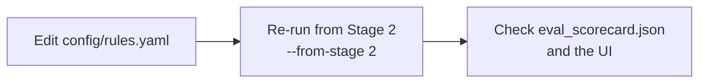

```bash
PY -m attacklens.run --raw data/raw/g1 --out data/out/g1 --from-stage 2
```

Example `match` rule. `where` is a SQL condition over the normalised event columns:
```yaml
rules:
  - id: office_spawns_script
    kind: match                       # match | template | sigma
    where: >-
      action = 'proc_start'
      AND lower(parent_process) IN ('winword.exe','excel.exe','outlook.exe')
      AND lower(process_name) IN ('powershell.exe','cmd.exe','wscript.exe','cscript.exe','mshta.exe')
    technique: T1059
    sub_technique: T1059.001
    tactic: Execution
    severity: 80
```

- `technique` must exist in `config/attack_v20.json` and `tactic` must be an ATT&CK v20 tactic. A test fails otherwise.
- `severity` is 1–100. Confidence = severity scaled by how rare the rule is on that host.
- `where` can use `{ioc.ips}`, `{ioc.domains}` and other lists from `config/ioc.yaml`.
- `kind: template` rules (for example `brute_force_then_success`) take thresholds from the `thresholds:` block.
- Sigma rules: put a `.yml` file under `config/sigma/`. It compiles at the next run (the cache is keyed on content).
- Rules come from trusted config. Do not load rule files from untrusted sources.

---

## 9. Data formats

Ingest routes each file by its content, not its extension. Paths containing `ground_truth`, `manifest.json` and
`*.md` files are skipped.

| Format | `source_type` | Note |
|---|---|---|
| ECS JSON lines | `ecs_json` | the provided generator's format; used for the synthetic sets |
| Windows EVTX exported as JSON | see `source_profile.json` | flat or nested `Event.System` / `Event.EventData` |
| Firewall CSV | `firewall_csv` | |
| Syslog (RFC 3164 / ISO-prefixed) | see `source_profile.json` | |
| CEF | see `source_profile.json` | extension keys only; the header name is not read |
| FortiGate key=value | `fortigate_kv` | the organiser's tier format |
| Cloud audit logs | `cloudtrail_json`, `azure_signin_json`, `azure_activity_json`, `azure_storageblob_json`, `gcp_audit_json` | section 11.2 |

Field aliases per format: `config/sources.yaml`. Stage 0 writes `source_profile.json` with what it found.

**No silent data loss.** Every run writes `ingest_accounting.json` with rows in, rows ok, dropped rows with reasons,
and quarantined rows per source. A drop above 0.1 % without a logged reason is treated as a bug. Example
(`data/out/g10/run_metrics.json`): 13,048,132 rows in, 13,048,132 ok, 0 dropped.

FortiGate note: one device logs everything, so the host is the device name and internal endpoints are identified
by IP (`docs/DEVELOPMENT.md` §15.9).

---

## 10. Detection coverage

### 10.1 Our rules

Generated from `config/rules.yaml`. One primary technique and tactic per rule.

| Rule id | Technique | Tactic | Signal |
|---|---|---|---|
| brute_force_then_success | T1110.001 (+ T1078 on success) | Credential Access | burst of failed logins per user and host, then a success |
| password_spray | T1110.003 (+ T1078) | Credential Access | one source IP failing for many users |
| account_created_then_elevated | T1136 (+ T1098) | Persistence | account created, then added to a group within 24 h |
| beaconing | T1071.001 | Command and Control | regular-interval connections to one destination |
| ransom_rename | T1486 | Impact | mass file renames in 60 s |
| exfil_volume | T1048 | Exfiltration | large outbound volume to an external IP in 15 min |
| new_admin_logon | T1021 (+ T1078) | Lateral Movement | rare privileged network logon for a user and host pair |
| office_spawns_script | T1059.001 | Execution | Office app starts a script engine |
| encoded_powershell | T1059.001 | Execution | encoded or hidden PowerShell, download cradle (also in PowerShell script blocks) |
| run_key_persistence | T1547.001 | Persistence | Run registry key set by a script engine |
| ioc_destination | T1071.001 | Command and Control | destination IP or domain in `config/ioc.yaml` |
| ransom_extension | T1486 | Impact | file written or renamed with a ransom extension |
| discovery_commands | T1087.002 | Discovery | `net user`, `net group`, `nltest`, `get-aduser` |
| discovery_system | T1082 | Discovery | `whoami`, `systeminfo` |
| service_or_task | T1543.003 | Persistence | service installed or `sc create` |
| scheduled_task | T1053.005 | Persistence | scheduled task created |
| log_cleared | T1070.001 | Defense Impairment | event log cleared or `wevtutil cl` |
| archive_staging | T1560.001 | Collection | 7z, rar, zip, tar, Compress-Archive |
| suspicious_cmd | T1059.003 | Execution | cmd.exe under an unusual parent |
| wmi_exec | T1047 | Execution | WMI-spawned shell or `wmic process call create` |
| unix_reverse_shell | T1059.004 | Execution | `bash -i`, `/dev/tcp/`, curl or wget piped to sh |
| indicator_removal_files | T1070.004 | Defense Impairment | `rm -rf /var/log`, `del /f /q` |
| disable_security_tools | T1562.001 | Defense Impairment | `Set-MpPreference -Disable...` |
| sudo_escalation | T1548.003 | Privilege Escalation | sudo on a rare user and host pair |
| lsass_dump | T1003.001 | Credential Access | mimikatz, sekurlsa, procdump on lsass |
| kerberoasting | T1558.003 | Credential Access | many service tickets with RC4 for one account |
| pass_the_hash | T1550.002 | Lateral Movement | logon type 9 with NTLM/negotiate on a rare pair |
| fw_admin_bruteforce | T1110.001 (+ T1078) | Credential Access | firewall admin login failures from an external IP, then success |
| fw_admin_spray | T1110.003 (+ T1078) | Credential Access | one external IP failing for many firewall admin accounts |
| vpn_bruteforce_success | T1110.001 (+ T1133) | Credential Access | VPN failures then success for one user |
| ips_signatures | T1190, T1110, T1071, T1590.002, T1210 | Initial Access and others (per signature) | IPS signature mapped to a technique |
| av_malware_download | T1105 | Command and Control | antivirus alert on a transfer |
| port_scan | T1046 | Discovery | many ports on one host or many hosts on one port in 60 s |
| internal_lateral | T1021 | Lateral Movement | rare internal SMB/RDP/WinRM/SSH connection |
| fw_config_change_after_login | T1562.004 | Defense Impairment | firewall config change soon after an external login |
| tor_or_proxy_app | T1090.003 | Command and Control | anonymising proxy app seen by app control |
| web_malicious_category | T1189 | Initial Access | web filter blocked a malicious category |

Cloud rules: `config/rules_cloud.yaml` (69 native + 18 behavioural, per `reports/cloud/README.md`).

### 10.2 The SigmaHQ catalogue

Two rule sources run in Stage 3 and write into the same alert table:

| Source | Where | Count | Notes |
|---|---|---|---|
| Our rules | `config/rules.yaml` | table above | hand-written, tuned against the eval harness |
| SigmaHQ rules | `config/sigma/` (mapping in `config/sigma_map.yaml`) | 3,779 files (`config/sigma/SOURCE.md`) | vendored unmodified, compiled by pySigma to DuckDB SQL, cached in `data/cache/sigma/` |

- A Sigma alert takes its label from the rule's own ATT&CK tag. A rule without a technique tag is skipped.
- A Sigma alert is dropped when one of our rules already covers the same event and host with the same technique or
  tactic (`sigma_alerts_deduped`). Our hand-tuned label wins.
- At most `sigma.max_alerts_per_rule` (1,000) alerts per rule per run; overflow is counted.
- Settings: `sigma:` block in `config/pipeline.yaml`. Live mode runs only `high` and `critical` Sigma rules.
- **Most Sigma rules cannot fire on most data sets.** They need a matching log source and fields. On firewall-only
  data only the `firewall`, `proxy`, `dns`, `webserver` and `fortigate_event` families can apply. A rule that
  compiled is not a rule that detected something.

Measured coverage, recorded on 2026-10-31 in `data/out/g50m_sigma/run_metrics.json` (`stage_stats.detect.sigma`,
a 50 MB synthetic set; that output folder is not in this checkout):

| Measure | Value |
|---|---|
| Rule files parsed / compiled / running | 3,779 / 1,672 / 1,657 |
| Rules that fired / Sigma alerts | 11 / 1,414 (1,314 of them from one rule) |
| Skipped: unmapped log source / unmapped field / no ATT&CK tag | 1,183 / 659 / 260 |

Sigma off against Sigma on, same 50 MB set (21 planted steps), from `eval_scorecard.json` of `g50m_nosigma` and
`g50m_sigma`:

| Measure | Sigma off | Sigma on |
|---|---|---|
| Detection | 100.0 % | 100.0 % |
| Correct labels | 100.0 % | 95.24 % |
| Attacks rebuilt | 100.0 % | 100.0 % |
| False alarms, strict | 0.0 % | 28.57 % |
| Incidents | 5 | 7 |

Do not read the Sigma-on row as a gain: on this set it added false alarms.

---

## 11. SIEM and cloud integrations

### 11.1 SIEM layer

**Status: code is in place and verified only against the local mock SIEM (`tools/mock_siem.py`). Nothing has been
tested against a real Elastic, Splunk, Sentinel or syslog source.** Everything is disabled by default; nothing touches
the network until you set `enabled: true` in `config/integrations.yaml`. Design: `docs/DEVELOPMENT.md` §8b.

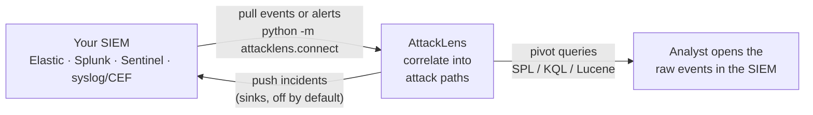

| SIEM | Inbound (pull) | Outbound (push) |
|---|---|---|
| Elastic / OpenSearch | `_search` with `search_after` (PIT when supported), raw events or alerts | sink `elastic_bulk`, index `attacklens-incidents` |
| Splunk | `services/search/jobs/export`, raw events or notables | sink `splunk_hec` |
| Microsoft Sentinel | Log Analytics KQL query, raw events or `SecurityAlert` | sink `webhook` |
| Generic syslog / CEF (e.g. QRadar) | syslog / CEF listener (UDP and TCP) | sink `syslog_cef` |
| Mitigata Gordon AI SOC | alerts (to confirm) | sink `webhook` (to confirm) |
| Any SOAR | none | sink `webhook` (`incident`, `summary` or `slack` payload) |

Input modes:

| Mode | Command | Where it lands | Labels come from |
|---|---|---|---|
| events | `python -m attacklens.connect --source <s> --mode events` | `data/raw/live/siem/<source>/...`; live mode ingests it | AttackLens rules |
| alerts | `python -m attacklens.connect --source <s> --mode alerts` | `data/spool/siem_alerts/<source>/*.jsonl` | the vendor's MITRE field |

- Full command: `python -m attacklens.connect --source elastic|splunk|sentinel|syslog [--mode events|alerts] [--since 24h] [--once] [--reset] [--config DIR]`.
  Exit code 2 if the connector is disabled, 1 if a `--once` cycle failed.
- Checkpoints: `data/spool/state/<source>_<mode>.json`. Status: `data/spool/connector_status.json`
  (`pulled` = `written` + `skipped` + `failed`, each with reasons).
- Batch alert mode: `python -m attacklens.run --raw <dir> --out data/out/<name> --siem-alerts` (refused together with
  `--ground-truth`). Never quote file-ingest accuracy for an alert-mode run.
- Secrets: `config/integrations.yaml` holds the **names** of environment variables, never values. If a named variable
  is not set, the connector refuses to call the SIEM.
- Pivot-back queries: `GET /api/incidents/{id}/pivots` returns, per step, a ready-to-run SPL, KQL or Lucene query
  scoped to the step's host, user and IPs within ±15 min.
- Sinks send an incident again only when it changed, and never fail a run (errors are logged and counted).

Try it offline against the mock SIEM (each command in its own terminal):

1. `PY tools/mock_siem.py --data data/raw/g1 --port 9200` (listens on 127.0.0.1 only).
2. In `config/integrations.yaml` set `connectors.elastic.enabled: true` and `api_key_env`, `user_env`,
   `password_env` to `null` (the mock has no auth). Revert after the demo.
3. `PY -m attacklens.connect --source elastic --mode alerts --since 7d --once`
4. `PY -m attacklens.run --raw data/raw/g1 --out data/out/siem1 --siem-alerts`
5. `ATTACKLENS_OUT=data/out/siem1 PY -m uvicorn attacklens.api:app --port 8000`, then
   `curl http://localhost:8000/api/incidents/<id>/pivots`.

If the pull returns `pulled: 0`, widen `--since` and check `data/spool/connector_status.json`.

Known limits: no overlap window for late-indexed data; Sentinel can stall on a page of identical timestamps; a
Splunk first pull is all-or-nothing; the Elastic PIT path is mock-tested only; the Gordon AI SOC row and the
Sentinel push are to confirm. Pull speed and accuracy against a real SIEM: not measured yet.

### 11.2 Cloud logs

- Formats: AWS CloudTrail, Entra ID sign-in, Azure Activity, Azure Storage blob, GCP Cloud Audit (section 9).
- Pull connectors `aws_cloudtrail`, `azure_monitor`, `sentinel`, `gcp_logging` are `enabled: false` by default.
  Exported JSON files work without any connector. The AWS and GCP connectors need `pip install -e "backend[cloud]"`.
- Rules: `config/rules_cloud.yaml`; settings: `config/cloud.yaml`. Optional offline IP-to-ASN table via
  `geo.asn_db_path`; nothing is downloaded at runtime.
- Some Entra / Azure role ids, error codes and AWS request shapes were not checked against live tenants
  (`reports/cloud/README.md`). Cloud accuracy, run time and memory: not measured yet.

---

## 12. API reference

Base URL `http://localhost:8000`. All reads come from memory.

| Method and path | Returns |
|---|---|
| `GET /api/health` | liveness, incident count, `served_out_dir`, `out_dir_source` (`api_run`, `env` or `newest`) |
| `GET /api/incidents` | incident index, risk descending |
| `GET /api/incidents/{id}` | full incident JSON |
| `GET /api/incidents/{id}/path` | path, branches and edges only (FR-5, FR-7) |
| `GET /api/incidents/{id}/pivots` | per step: SPL / KQL / Lucene query that opens the raw events in the SIEM |
| `GET /api/metrics` | `run_metrics` + `eval_scorecard` + `ingest_accounting` |
| `POST /api/uploads` (multipart, field `files`, repeat per file) | streams files into `data/raw/uploads/<upload_id>/` (201) |
| `POST /api/uploads/local` body `{"path": "..."}` | hard-links a file already on this machine (201) |
| `GET /api/uploads` | uploads, newest first |
| `POST /api/runs` body `{"raw_dir", "out_dir"?, "ground_truth"?}` | starts a background run (202 `{run_id}`; 409 if one is running) |
| `GET /api/runs`, `GET /api/runs/{id}` | runs since the API started; stage, percent, elapsed, memory, error |
| `GET /api/live/status` | live-mode state |
| `GET /api/integrations/status` | connectors and sinks: enabled, last pull, counts, whether each env var is set (never its value) |
| `POST /api/reload` | re-read the output folder |

Error codes for uploads and runs:

| Call | Errors |
|---|---|
| `POST /api/uploads` | 400 not multipart, empty or unsafe file name, no `files` part, client disconnected (partial upload removed); 413 over `upload.max_bytes`; 415 extension not allowed; 507 not enough free disk |
| `POST /api/uploads/local` | 400 path not absolute or not a regular file; 403 outside `upload.local_roots`; 404 not found; 413 too large; 415 extension; 507 no free disk (copy fallback only) |
| `POST /api/runs` | 400 invalid path or not a directory; 409 a run is already in progress |
| `GET /api/runs/{id}` | 404 unknown run id |

The whole upload-and-analyse flow from a terminal (bash; replace the paths):
```bash
# 1. register a file already on this machine (hard link, no copy) ...
curl -s -X POST http://localhost:8000/api/uploads/local \
  -H "Content-Type: application/json" -d '{"path": "C:/logs/firewall.log"}'
# ... or upload files
curl -s -X POST http://localhost:8000/api/uploads -F "files=@/path/to/a.log" -F "files=@/path/to/b.csv"
# 2. start the run with the raw_dir from the response
curl -s -X POST http://localhost:8000/api/runs \
  -H "Content-Type: application/json" -d '{"raw_dir": "data/raw/uploads/<upload_id>"}'
# 3. poll until status is "succeeded"
curl -s http://localhost:8000/api/runs/<run_id>
# 4. read the results
curl -s http://localhost:8000/api/incidents
```

Limits the API enforces (`backend/attacklens/api_upload.py`, `api_runs.py`, `config/pipeline.yaml` `upload:`):

| Rule | Value |
|---|---|
| Upload folder | `data/raw/uploads/<upload_id>/`, written under `.incoming/` first and renamed when complete, so a partial upload is never analysed |
| File names | basename only; characters outside `[A-Za-z0-9._-]` become `_`; duplicates get `-1`, `-2` |
| `upload.max_bytes` | 68,719,476,736 (64 GiB per upload) |
| `upload.min_free_bytes` | 2,147,483,648 (2 GiB must stay free, checked during the write) |
| `upload.local_roots` | `null` = any local path; set a list of folders to restrict `POST /api/uploads/local` |
| `raw_dir` / `out_dir` | `raw_dir` inside `data/raw/`; `out_dir` exactly `data/out/<name>` (default from `raw_dir`); the live-mode folder is refused |
| `ground_truth` | optional, a file inside `data/raw/` |

---

## 13. Design decisions

Where we deliberately differ from the literal spec. Each one is switchable in config (`docs/DEVELOPMENT.md` §15.7).

- **Path order rule.** Initial Access, Credential Access and Lateral Movement do not raise the per-host tactic floor.
  Real attacks run Credential Access (9) before Initial Access (3), and Lateral Movement (11) before Execution (4); the
  literal rule makes that order impossible.
- **Link rule R3.** The source step must be Credential Access, Persistence, Privilege Escalation or Initial Access with
  confidence ≥ 60, and the target user must match. Without this, shared user names linked all the noise.
- **Gate.** Episodes with confidence < 40 join a component but do not count toward the tactic count. A single-tactic
  component passes only if its top episode merged at least 5 alerts.
- **Several incidents per component.** Incidents are peeled from large components, so one noise chain cannot hide a
  second attack.
- **Hub and baseline thresholds.** `hub_min_median_daily_peers: 40` and `baseline_max_other_rules: 99`, chosen by a
  sweep on g1, because generator users touch all 28 hosts daily.
- **new_admin_logon.** Skipped for routine (user, host) pairs with at least 3 earlier non-privileged logons during
  08–19 UTC. This separates admin work from an attack without using labels.
- **Source-host link window.** The R1 source-host variant uses 6 h instead of 24 h.
- **Risk scale.** `raw_ref_score: 30.8` (S1's raw score on g1) instead of 15, because 15 saturated two attacks at 100.
- **Tactic names.** ATT&CK v20 (15 tactics): Stealth and Defense Impairment replace Defense Evasion. The harness maps
  them back if the organiser's ground truth uses the old name.

---

## 14. Security, LLM safety and data handling

**Network exposure.** The API binds to 127.0.0.1, and `docker-compose.yml` publishes the port as `127.0.0.1` only.
`POST /api/uploads/local` can make the API read any file the API process can read, and `POST /api/runs` starts jobs.
Neither has authentication. Do not run `uvicorn --host 0.0.0.0` or publish the port on a shared network; if you must,
set `upload.local_roots` first.

**LLM safety.**
- The report model sees placeholders (`{{HOST_1}}`, `{{USER_1}}`) and enums (technique, tactic), never raw log text.
- No API key, any error, an unknown token in the output, or a missing step: the deterministic template is used.
- The template is the default. The demo needs no network and no key. The UI shows a `llm` or `template` badge.
- Log content is never rendered as HTML in the UI.

**Data handling.**
- Synthetic or organiser-provided data only. AttackLens does not scan or attack any system.
- No real credentials are in the repository. Test keys are visibly fake.
- The organiser's FortiGate tiers are confidential: used only for this hackathon, not published, not copied into tests,
  fixtures or reports. `data/` is git-ignored.
- FortiGate accuracy is measured on synthetic data from `tools/fortigate_gen.py`. No real log lines are copied.

---

## 15. Repository layout

| Folder | What is in it |
|---|---|
| `backend/attacklens/` | the pipeline (profile, ingest, detect, episodes, link, incidents, reach-next, publish), the API, live mode, connectors |
| `backend/eval/` | the evaluation harness that scores a run against planted ground truth, and its probe tests |
| `backend/tests/` | unit, integration and QA tests with small synthetic fixtures |
| `frontend/` | React + Vite + Cytoscape.js web UI |
| `config/` | rules, field aliases, link windows, thresholds, ATT&CK v20 data, SigmaHQ rules |
| `tools/` | synthetic data generators, mock SIEM / cloud / SaaS services, QA and performance scripts |
| `docs/` | requirements (PRD), architecture, testing, demo script, benchmark |
| `reports/` | measured stress, QA, robustness and cloud reports; the provided log generator |
| `slides/` | finals presentation and screenshots |
| `Dockerfile`, `docker-compose.yml` | one image with API + built UI + pipeline + demo-data generator |

---

## 16. Disclosures (third-party components)

Checked against `backend/pyproject.toml`, `frontend/package.json`, `Dockerfile` and `docker-compose.yml`. Licenses as
published by each project.

### Python (backend)

| Component | License | Use |
|---|---|---|
| DuckDB | MIT | ingest, detection, joins |
| NetworkX | BSD-3-Clause | graph helpers |
| FastAPI | MIT | API |
| Uvicorn | BSD-3-Clause | API server |
| Pydantic | MIT | incident contract |
| PyYAML | MIT | config loading |
| psutil | BSD-3-Clause | memory telemetry |
| Jinja2 | BSD-3-Clause | template report |
| python-multipart | Apache-2.0 | streaming multipart parser for `POST /api/uploads` |
| Anthropic SDK | MIT | optional (`backend[llm]`); report wording; off without a key |
| pySigma | LGPL-2.1-only | required dependency; parses and compiles the vendored SigmaHQ rules; used unmodified |
| boto3 (and botocore) | Apache-2.0 | optional (`backend[cloud]`); AWS CloudTrail connector; off by default |
| cryptography | Apache-2.0 OR BSD-3-Clause | optional (`backend[cloud]`); signing of the GCP service-account JWT |
| pytest | MIT | tests (dev) |
| httpx | BSD-3-Clause | API tests (dev) |

Transitive Python packages that matter for licensing (read from the installed `.dist-info/METADATA`):

| Package (installed version) | License | Pulled in by |
|---|---|---|
| diskcache 5.6.3, diskcache-stubs | Apache-2.0 | pySigma |
| google-re2 1.1.20251105 | BSD | pySigma |
| jq 1.13.0 | BSD-2-Clause | pySigma |
| packaging 26.3 | Apache-2.0 OR BSD-2-Clause | pySigma |
| pyparsing 3.3.3 | MIT | pySigma |
| requests 2.34.2 | Apache-2.0 | pySigma |
| types-PyYAML | Apache-2.0 | pySigma |
| urllib3 2.8.0 | MIT | requests |
| certifi 2026.10.23 | MPL-2.0 (used as installed, not modified) | requests |
| charset-normalizer 3.5.2 | MIT | requests |
| idna 3.20 | BSD-3-Clause | requests |
| Starlette 1.10.0 | BSD-3-Clause | FastAPI |
| anyio 4.15.1 | MIT | Starlette (also imported by `api_upload.py`) |

### JavaScript (frontend)

| Component | License | Use |
|---|---|---|
| React, React DOM | MIT | UI |
| Vite, @vitejs/plugin-react | MIT | build and dev server |
| Tailwind CSS, @tailwindcss/vite | MIT | styling |
| @fontsource-variable/geist, @fontsource-variable/geist-mono | OFL-1.1 | fonts, served locally, no CDN |
| Cytoscape.js, cytoscape-dagre | MIT | graph rendering and layout |
| TypeScript | Apache-2.0 | type checking |
| oxlint | MIT | linting |
| @types/* (DefinitelyTyped) | MIT | type definitions |

### Container images

| Image | Use |
|---|---|
| `node:22-slim` | builds the web UI (first build stage) |
| `python:3.12-slim` | runtime: API, pipeline, demo-data generator |

### Data, rules and tools

| Component | License / terms | Use |
|---|---|---|
| MITRE ATT&CK v20 (`config/attack_v20.json`) | MITRE Terms of Use | technique and tactic names and order; merged from the official STIX bundle `enterprise-attack-20.0.json`. ATT&CK® is a registered trademark of The MITRE Corporation |
| SigmaHQ detection rules (`config/sigma/`) | Detection Rule License (DRL) 1.1 | 3,779 rule files vendored unmodified from https://github.com/SigmaHQ/sigma at commit `05d1031f537e830b76da53bae2400c5814c89165` (`config/sigma/SOURCE.md`) |
| DataDog Stratus Red Team | Apache-2.0 | cloud: technique list, event names, test plan |
| Splunk security_content (`detections/cloud`) | Apache-2.0 | cloud rules: thresholds and patterns |
| Azure-Sentinel analytic rules | MIT | cloud rules: operation names, result codes, thresholds |
| Panther panther-analysis (`aws_cloudtrail_rules`) | Apache-2.0 | cloud rules: lists and patterns |
| Elastic detection-rules | Elastic License 2.0 | cloud rules: logic inspired by; no query text copied |
| iptoasn.com ip2asn tables (optional, not shipped) | PDDL 1.0 | offline IP to ASN / country |
| AWS `ip-ranges.json`, Google `cloud.json`, Azure Service Tags (optional, not shipped) | public feeds | cloud provider IP ranges |
| `reports/edr_log_generator.py` | organiser/team-provided test-data tool | synthetic logs; wrapped by `tools/gen_dataset.py`, not edited |
| Organiser FortiGate log tiers | confidential, organiser-provided | hackathon use only; not published |

#### Sigma attribution (DRL 1.1)

The rules are licensed under the Detection Rule License 1.1. Full text: `config/sigma/LICENSE.Detection.Rules.md`;
repository notice: `config/sigma/LICENSE.md`.

| DRL 1.1 condition | How AttackLens meets it |
|---|---|
| Keep the `author` field and other attribution in shared rules | Rule files are copied unmodified, each keeps `author`, `id`, `references` |
| Keep a link to the rule set | https://github.com/SigmaHQ/sigma (commit above) |
| Say the rules are under the DRL and link or include its text | This section and `config/sigma/LICENSE.Detection.Rules.md` |
| Messages based on a match keep the rule's `author` | Alerts carry the rule id `sigma_<first 8 hex of the Sigma id>`; `data/out/<set>/work/sigma_coverage.json` maps each fired id to its title. Whether the UI shows the rule author on each alert: not verified |

AI tools: Claude Code (Anthropic) was used during development, including code, tests and documentation.

Ideas only (no code copied) from: Zircolite, Chainsaw, Hayabusa, Elastic detection-rules, BloodHound, and the
RapSheet, HOLMES, NoDoze, Hopper and SAGE papers.

---

## 17. More documents

| File | Content |
|---|---|
| `docs/PRD.md` | the organiser's requirements |
| `docs/DEVELOPMENT.md` | architecture, schemas, formulas |
| `docs/TESTING.md` | tests, data generation, stress tests |
| `docs/DEMO.md` | 5-minute live demo script |
| `docs/BENCHMARK.md` | all measured numbers, next to other tools' published claims |
| `reports/stress/` | stress-test reports per data size and for the real FortiGate tiers |
